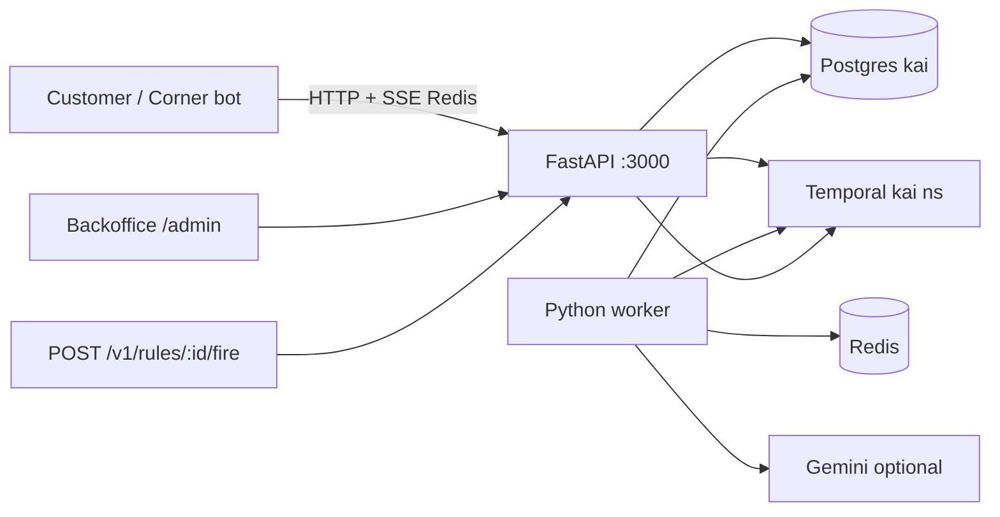
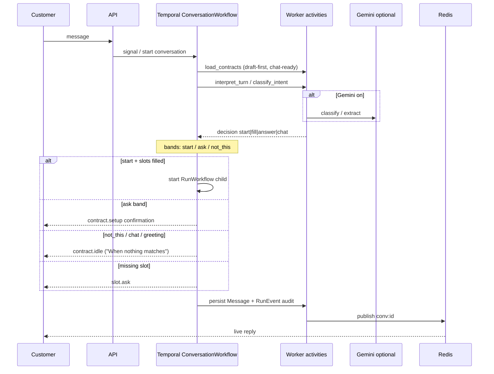
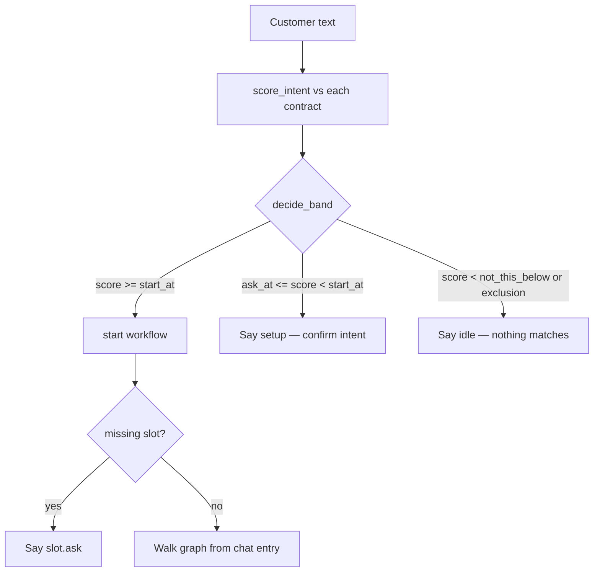
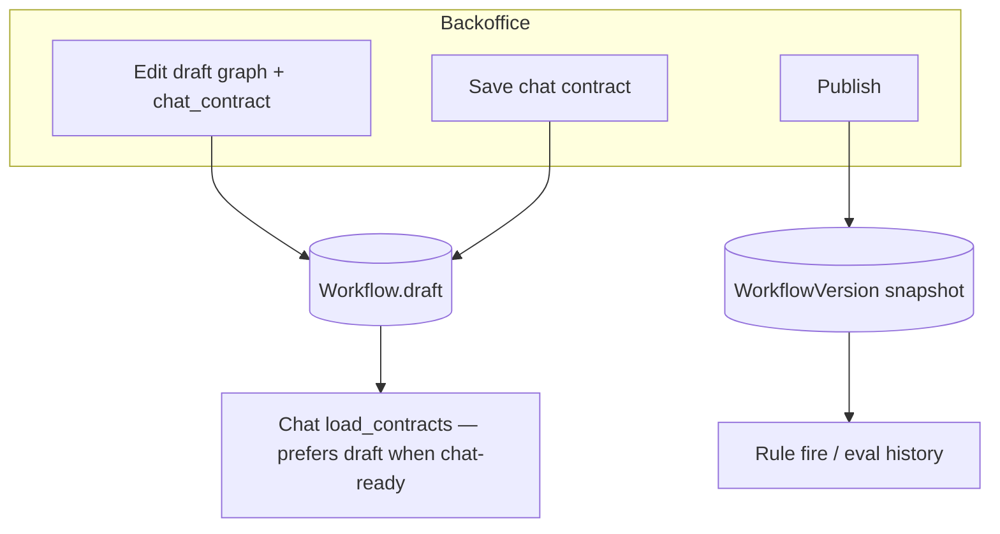
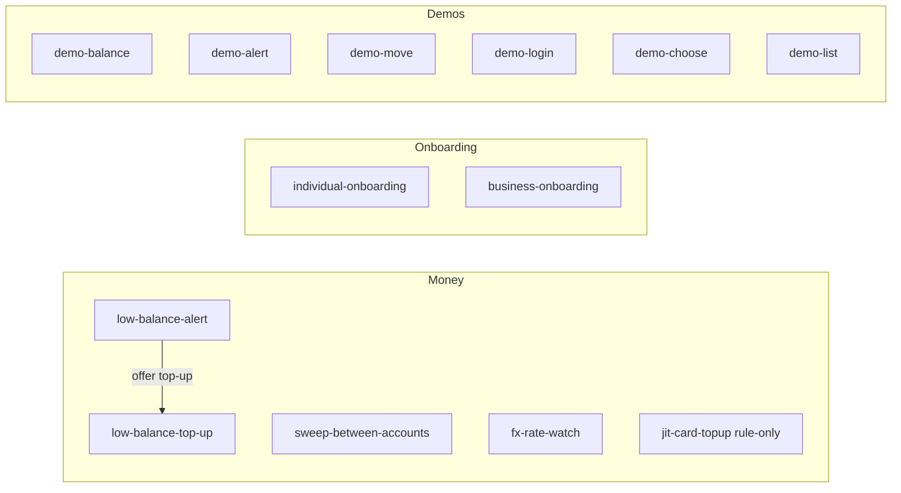

# Kai architecture

Kai is a draft-first money chat bot: the backoffice edits a workflow **draft** (graph + chat contract + stories); chat classifies against loaded drafts; publish snapshots a version for rule fires and eval history.

## System context

## Runtime path — chat turn

## Chat contract fields (backoffice Chat tab)

| Field | Admin label | Runtime use |
| --- | --- | --- |
| `setup` | **Setup** | Customer-facing confirmation when confidence is in the **ask** band. Preferred over `lines[chat entry]` for that ask. |
| `idle` | **When nothing matches** | Said on **not_this**, exclusions, greetings with no start, or no workflow key. Try-it shows it for exclusion chips. |
| `description` | Description the classifier reads | Scoring / Gemini intent text (not spoken). |
| `examples` | Examples | High-confidence starts; also feed Try-it chips via `sync_try_prompts`. |
| `exclusions` | Not this | Force low score / chat; appear on Try-it as negatives. |
| `bands` | How sure Kai must be | `start_at` / `ask_at` / `not_this_below` → band decision. |
| `slots` | What Kai fills, or asks | Pre-graph questions when `fill_from` is set. |
| `lines` | What Kai says | Spoken lines keyed by step id. |
| `never` | Kai never | Guardrails: forbidden phrases blocked live on Kai lines; scored as `guardrails` on the run (0 flags). Order rules checked on the event timeline. |
| `try_prompts` | Try it chips | Always = examples + exclusions (`sync_try_prompts`). |

## Draft-first vs publish

- **Chat** loads the draft when the graph is chat-ready; otherwise the published version.
- **Rules** use the published version only.
- Creating a workflow from a template copies draft and sets `built_from`.
- Deleting a workflow removes runs/scores/events for that workflow; orphan cleanup applies where implemented.

## Catalog workflows (seeded)

Intent routing (deterministic boosts + Gemini when enabled):

- Alert phrases (`tell me when` / `goes under` / `below N`) → alert, not balance listing or top-up.
- `top up` / `refill` / `add … to` → top-up.
- `Move … from … to …` → sweep.
- Exclusions and `idle` keep mismatches out of the wrong graph.

## Audit trail

Every interpret / classify / step advance persists `RunEvent` rows (start, condition, fetch, action, reply/timeout) and message payloads so Intelligence can show who decided what (deterministic vs Gemini), confidence, band, and step trace.

Finished runs get `RunScore` with chat checks (`intent`, `slots`, `turns`, `lines`, `guardrails`) and outcome checks (`right_end`, `speed`, `finished`, `no_errors`). **Kai never** feeds `guardrails`.

## Draft → live chat

`load_contracts` prefers each workflow’s **saved draft** when it has a chat entry (and a published version exists for the tenant). Saving the chat contract in the backoffice updates the draft immediately — examples, slots, Setup, idle, and Kai never apply to the next chat turn without publishing. Publish still snapshots a version for rule fires and eval history.

## Local stack

| Service | Port |
| --- | --- |
| API + admin static | 3000 |
| Temporal UI | 8081 |
| Postgres (kai) | 5433 → 5432 |
| Redis | 6380 → 6379 |
| Temporal gRPC | 7233 |

Seed: `docker compose run --rm api python -m kai.seed`  
Demo refresh only: `docker compose run --rm api python -m kai.install_demos`
